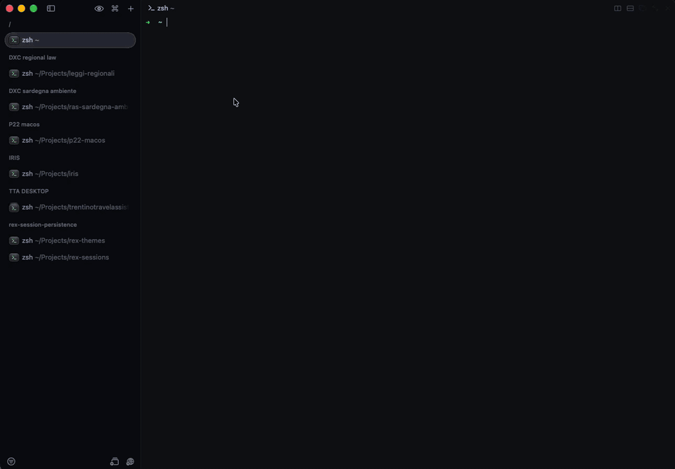

# rex-sessions

Save and restore [Rex](https://www.superlogical.com/rex) sessions, so updating or restarting the Rex server doesn't lose your workspace.

It snapshots every session (windows, split layout and ratios, pane labels, working directories) and recreates the missing ones later with a single atomic `session.create` call per session.

Pure Python standard library, no dependencies. Talks to Rex only through the `rex` CLI.



## Install

```sh
git clone https://github.com/AlbertoBarrago/rex-sessions.git
cd rex-sessions
./install.sh                   # links bin/rex-sessions into ~/.local/bin
./install.sh /usr/local/bin    # or any other directory on PATH
rex-sessions autosave on       # snapshot every 120s via launchd
rex-sessions status            # verify everything is wired up
```

Requires Python 3.11+ and `rex` on `PATH` (or `REX_BIN`). The install is a symlink, so updating the clone updates the CLI.

## Usage

```sh
rex-sessions status                       # server, autosave agent, last snapshot, what restore would do
rex-sessions save                         # snapshot now
rex-sessions list                         # saved snapshots, newest last
rex-sessions show [FILE]                  # session > tab > pane tree with cwd and program
rex-sessions restore --dry-run            # what would be recreated
rex-sessions restore                      # recreate sessions missing from the server
rex-sessions restore --session IRIS       # only one session (repeatable)
rex-sessions restore --from <file>        # from an older snapshot
rex-sessions autosave on [--interval N]   # install and start the launchd agent
rex-sessions autosave off
```

Typical flow after a Rex update: open Rex, run `rex-sessions restore`. `status` exits 1 when a check fails (no `rex`, server unreachable, agent installed but not loaded), so it also works in scripts.

## Behavior

- **Restore is idempotent**: sessions are matched by label, existing ones are skipped.
- **Panes restart as shells in their old cwd.** The foreground program (e.g. `nvim`) is recorded in the snapshot as `program` but never re-run. A cwd that no longer exists falls back to home.
- **Autosave guard**: `save --auto` (used by the agent) does nothing while the server has been up for less than 10 minutes (`--min-uptime`). This keeps the pre-update snapshot as `latest.json` until you restore.
- **History**: a new snapshot is written only when the state changes; the last 50 are kept (`--keep`).
- `rex` is always invoked with `--autostart=false`, so the tool never starts a server.

## Storage

`~/Library/Application Support/rex-sessions/` (override with `REX_SESSIONS_DIR`):

- `snapshot-<UTC timestamp>.json`: history
- `latest.json`: copy of the newest snapshot, the default for `restore`
- `autosave.log`: launchd agent output

## Limitations

- Floating layers and detached blocks are not saved (a warning is printed).
- Scrollback is not saved.
- Restored sessions are appended at the end of the session list.
- Only the local server is snapshotted.

## Development

```sh
python3 -m unittest discover -s tests -v
```
